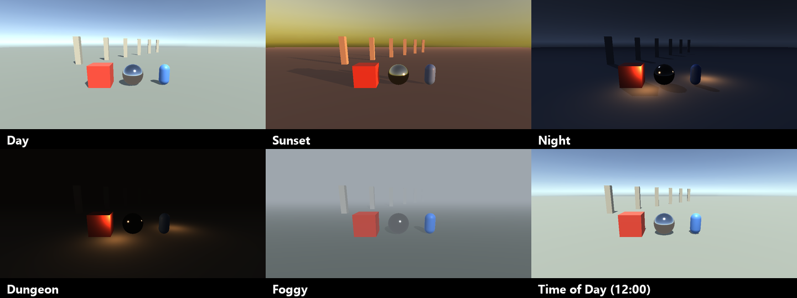
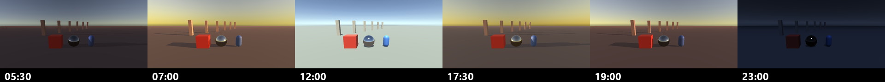

# Environment

**One-click scene environments for Unity 6**: sun, skybox, ambient light, fog, sky reflections and URP
post-processing from presets: **Day, Sunset, Night, Dungeon, Foggy**. Smooth transitions at runtime
and a **day/night cycle**.

[English](#english) · [Türkçe](#türkçe)



---

<a name="english"></a>
# English

- **Environment window** (`Window > Atthree > Environment`): pick a preset, tick what to build, click
  **Apply to Current Scene** or **New Scene with This Environment**. Undo works (Ctrl+Z).
- Builds an `[Environment]` object with a **sun** (or reuses your Directional Light), a **URP Global
  Volume**, a **ground** plane and a **camera** if the scene has none. Running it again updates the
  scene and doesn't add duplicates.
- **Presets** are assets (`EnvironmentPreset`): sun angle/color/shadows, procedural sky or solid color
  or your own skybox material, ambient light, fog, and post-processing (tonemapping, exposure,
  contrast, saturation, white balance, bloom, vignette). Edit one and the scene **updates live**.
- **Sky reflections**: the sky (or the fog color) is drawn into a cubemap and used as the scene's
  reflection, so metal and shiny surfaces look right, also in the editor without baking.
- **Runtime transitions**: `controller.TransitionTo(nightPreset, 3f)` blends everything smoothly.
  Turning things on/off (sun, fog, post) fades instead of popping.
- **Time Of Day**: presets placed at hours (night → dawn → day → sunset → night). The sun moves across
  the sky. At night the same light becomes the moon, and it fades out at the horizon.
- **Without URP** it still works: post-processing is skipped, everything else is applied.

**Requirements:** Unity 6 (6000.0+). URP 14+ is optional, needed only for post-processing.

## Step-by-step setup

### 1. Add the package

**Window > Package Manager** → **+** → **Install package from git URL…** →

```
https://github.com/Atthree/Environment.git
```

To lock a version: `https://github.com/Atthree/Environment.git#v0.1.0`

### 2. Build an environment (no code)

1. **Window > Atthree > Environment**.
2. Click a preset card, e.g. **Sunset**.
3. Under **Build**, untick what you don't want. If you already have a level, turn off **Ground**.
   Turn on **Day/night cycle** if you want time to pass.
4. Click **Apply to Current Scene**.

The scene now has an `[Environment]` object. Its materials and the Volume Profile are saved to
`Assets/Settings/Environment/<SceneName>/` (you can change the folder in the window).

Shortcut: **GameObject > Atthree > Environment (Day)** in the Hierarchy menu.

### 3. Switch or edit presets

- Select `[Environment]`. The Inspector shows a button for every preset: click one to apply it.
- The built-in presets are read-only (they live in the package). To change one, click **Copy to
  Project** (in the window or on the preset), then edit the copy. While the scene uses that preset,
  every change shows up immediately.
- New preset from scratch: Project window → right click → **Create > Atthree > Environment > Preset**.

### 4. Change the environment while playing

```csharp
using Atthree.Environments;
using UnityEngine;

public class CaveEntrance : MonoBehaviour
{
    public EnvironmentPreset inside;   // e.g. Dungeon
    public EnvironmentPreset outside;  // e.g. Day

    void OnTriggerEnter(Collider other)
    {
        if (other.CompareTag("Player")) EnvironmentController.Current.TransitionTo(inside, 2f);
    }

    void OnTriggerExit(Collider other)
    {
        if (other.CompareTag("Player")) EnvironmentController.Current.TransitionTo(outside, 2f);
    }
}
```

More:

```csharp
var env = EnvironmentController.Current;
env.SetPreset(night);                    // instant
env.TransitionTo(sunset, 4f);            // smooth
env.PresetChanged += p => Debug.Log(p.name);

// Presets from code, no asset needed
var foggy = EnvironmentPreset.Create(BuiltInEnvironment.Foggy);

// Your own weather system: blend two looks yourself and apply the result
var look = EnvironmentSettings.Lerp(clear.settings, storm.settings, stormAmount);
env.Apply(look, refreshLightingNow: false);
```

### 5. Day/night cycle

1. Tick **Day/night cycle** in the window before building, or **Add Component > Atthree >
   Environment > Time Of Day** on `[Environment]`.
2. In **Keys**, each entry is an hour and a preset. The defaults are Night 4:30, Dawn 6:30,
   Day 9:00 and 16:00, Sunset 18:18, Night 20:30. Hours between two keys blend the two presets.
3. **Day Length Minutes** sets how many real minutes one game day lasts.
4. Drag **Hour** in the Inspector to preview any time, in Edit mode too.

```csharp
var cycle = FindAnyObjectByType<TimeOfDay>();
cycle.Hour = 22f;                 // jump to 22:00
cycle.running = false;            // stop the clock
if (cycle.IsNight) SpawnZombies();
cycle.HourChanged += h => clockText.text = $"{(int)h:00}:{(int)(h % 1 * 60):00}";
```



### 6. Try the demo

1. **Window > Package Manager** → **Environment** → **Samples** → **Demo** → **Import**.
2. New empty scene → **GameObject > Create Empty** → **Add Component > Environment Demo**.
3. **Play**. Use the buttons at the top left to switch presets (2 s transitions), or turn on
   **Day/Night Cycle** and drag the time slider. Torches light up when it gets dark.

## Where to use it

| Game | Use |
|---|---|
| Any 3D prototype | Build a good-looking scene in one click instead of the default grey one |
| Open world / survival | Time Of Day with a 10–30 minute day; check `IsNight` for spawns |
| Dungeon crawler / indoor | **Dungeon** preset, then place your own torches/point lights |
| Horror | **Foggy** or **Night**, make a copy and push the fog density up |
| Levels with indoor and outdoor parts | Trigger zones calling `TransitionTo` (cave, building, portal) |
| Menus / cutscenes | `TransitionTo` between presets for mood changes |

## Good to know

- **One controller per scene.** `EnvironmentController.Current` is the active one.
- **Post-processing needs URP as the active pipeline** (Project Settings > Graphics) and **Post
  Processing** enabled on the camera. The builder turns it on for the camera it finds or creates.
- The `[Environment]` Global Volume has priority 10, so it wins over a default Global Volume from the
  URP template. Delete the old one if you don't need it.
- In Play mode the controller works on **copies** of the skybox material and the Volume Profile, so
  your assets don't change when you test transitions.
- While **Time Of Day** is on, it drives the look and the Preset field is ignored. Turn the component
  off to go back to the preset.
- Ambient light defaults to **Trilight** (sky/equator/ground colors) because it works the same in the
  editor and in builds without baking. The **Skybox** mode is available on each preset.
- Ambient light and reflections are refreshed at most every **Lighting Refresh Interval** seconds
  (0.5) during transitions and the cycle, and once more at the end.

## Using it with Synty / other packs

- Leave **Ground** off; the pack's level is the ground.
- If the pack's demo scene has its own lighting (a Directional Light, a Global Volume), the builder
  **reuses** the Directional Light and puts its own Volume on top (priority 10).
- Dark interiors: start from **Dungeon** and add point lights to the pack's torch meshes. The ambient
  is kept low on purpose so your lights stand out.

## Troubleshooting

| Problem | Fix |
|---|---|
| No bloom/vignette/color change | URP must be the active pipeline, and the camera needs **Post Processing** ticked. |
| The look changed after I opened another scene | Each scene has its own `[Environment]`; apply a preset in that scene too. |
| My edits to a built-in preset are greyed out | Built-ins are read-only: **Copy to Project** and edit the copy. |
| The scene is too dark indoors | Raise the preset's ambient colors or **Post Exposure**, or add lights. |
| The sky looks wrong but objects are fine | Check the preset's **Sky > Mode**. Foggy and Dungeon use a solid color on purpose. |
| Shiny objects don't reflect the sky | **Sky Reflections** on the controller must be on. Your own reflection probes take over where they cover. |

## How it works

- `EnvironmentSettings` is a struct with sun, sky, ambient, fog and post settings.
  `EnvironmentSettings.Lerp` blends two of them with no allocations: colors and numbers are blended,
  on/off parts fade through zero, and mode switches happen halfway.
- `EnvironmentController.Apply` writes to `RenderSettings` (skybox, ambient, fog), the sun light, the
  camera background, and the overrides of a URP `VolumeProfile`. URP code is compiled only when URP is
  installed (`ATTHREE_URP` version define).
- Sky reflections: a hidden camera that draws only the sky renders into a cube `RenderTexture` with
  mipmaps, which is set as `RenderSettings.customReflectionTexture`.
- `TimeOfDay` finds the two keys around the current hour (wrapping past midnight), smooth-steps
  between them, then replaces the sun angle with a path from the east (sunrise) to the west (sunset).

## Tests

25 PlayMode tests (22 without URP): presets applied to sun/fog/ambient/sky/camera, sky reflections,
transitions (mid-blend, arrival, retarget during a transition, zero duration), `Lerp` (endpoints,
fading the sun and fog on/off, shortest yaw), Time Of Day (sun at noon and at the horizon, blending,
wrapping past midnight, running clock, driver hand-off), the builder (no duplicates, reusing your
light, adding the cycle), URP volume overrides and that assets are not modified in Play mode.

To run them, add to `Packages/manifest.json`:

```json
"testables": [ "com.atthree.environment" ]
```

then **Window > General > Test Runner > PlayMode > Run All**.

## License

[MIT](LICENSE.md)

---

<a name="türkçe"></a>
# Türkçe

- **Environment penceresi** (`Window > Atthree > Environment`): bir preset seç, neleri kuracağını
  işaretle, **Apply to Current Scene** ya da **New Scene with This Environment**'a bas. Ctrl+Z ile
  geri alınır.
- Sahneye bir `[Environment]` objesi kurar: **güneş** (varsa senin Directional Light'ını kullanır),
  **URP Global Volume**, **zemin** ve sahnede yoksa **kamera**. Tekrar çalıştırırsan sahneyi günceller,
  kopya eklemez.
- **Preset**'ler asset'tir (`EnvironmentPreset`): güneşin açısı/rengi/gölgesi, procedural gökyüzü ya da
  düz renk ya da kendi skybox materyalin, ortam ışığı, sis ve post-processing (tonemapping, pozlama,
  kontrast, doygunluk, beyaz dengesi, bloom, vinyet). Birini düzenlediğinde sahne **anında güncellenir**.
- **Gökyüzü yansıması**: gökyüzü (ya da sis rengi) bir cubemap'e çizilip sahnenin yansıması yapılır;
  metal ve parlak yüzeyler doğru görünür. Bake gerekmez, editörde de çalışır.
- **Oyun içi geçiş**: `controller.TransitionTo(gecePreset, 3f)` her şeyi yumuşakça karıştırır.
  Açılıp kapanan şeyler (güneş, sis, post) birden değişmez, yavaşça söner/belirir.
- **Time Of Day (gün döngüsü)**: saatlere preset yerleştirirsin (gece → şafak → gündüz → gün batımı →
  gece). Güneş gökyüzünde ilerler; gece aynı ışık ay olur ve ufukta yumuşakça söner.
- **URP yoksa** da çalışır: post-processing atlanır, geri kalan her şey uygulanır.

**Gereksinimler:** Unity 6 (6000.0+). URP 14+ isteğe bağlı, sadece post-processing için gerekir.

## Adım adım kurulum

### 1. Paketi ekle

**Window > Package Manager** → **+** → **Install package from git URL…** →

```
https://github.com/Atthree/Environment.git
```

Sürüm sabitlemek için: `https://github.com/Atthree/Environment.git#v0.1.0`

### 2. Ortam kur (kodsuz)

1. **Window > Atthree > Environment**.
2. Bir preset kartına tıkla, örneğin **Sunset**.
3. **Build** altında istemediklerinin işaretini kaldır. Hazır bir haritan varsa **Ground**'u kapat.
   Zamanın akmasını istiyorsan **Day/night cycle**'ı aç.
4. **Apply to Current Scene**'e bas.

Sahnede artık `[Environment]` objesi var. Materyaller ve Volume Profile
`Assets/Settings/Environment/<SahneAdı>/` içine kaydedilir (klasörü pencereden değiştirebilirsin).

Kısayol: Hierarchy menüsünde **GameObject > Atthree > Environment (Day)**.

### 3. Preset değiştir ya da düzenle

- `[Environment]`'ı seç. Inspector'da her preset için bir düğme var; tıklayınca uygulanır.
- Paketle gelen preset'ler salt-okunurdur (paketin içindeler). Değiştirmek için **Copy to Project**'e
  bas (pencerede ya da preset'in üstünde), sonra kopyayı düzenle. Sahne o preset'i kullanırken her
  değişiklik anında görünür.
- Sıfırdan preset: Project penceresi → sağ tık → **Create > Atthree > Environment > Preset**.

### 4. Oyun sırasında ortamı değiştir

```csharp
using Atthree.Environments;
using UnityEngine;

public class MagaraGirisi : MonoBehaviour
{
    public EnvironmentPreset ic;   // ör. Dungeon
    public EnvironmentPreset dis;  // ör. Day

    void OnTriggerEnter(Collider other)
    {
        if (other.CompareTag("Player")) EnvironmentController.Current.TransitionTo(ic, 2f);
    }

    void OnTriggerExit(Collider other)
    {
        if (other.CompareTag("Player")) EnvironmentController.Current.TransitionTo(dis, 2f);
    }
}
```

Diğerleri:

```csharp
var env = EnvironmentController.Current;
env.SetPreset(gece);                     // anında
env.TransitionTo(gunBatimi, 4f);         // yumuşak
env.PresetChanged += p => Debug.Log(p.name);

// Asset olmadan koddan preset
var sisli = EnvironmentPreset.Create(BuiltInEnvironment.Foggy);

// Kendi hava durumu sistemin: iki görünümü kendin karıştırıp uygula
var gorunum = EnvironmentSettings.Lerp(acik.settings, firtina.settings, firtinaMiktari);
env.Apply(gorunum, refreshLightingNow: false);
```

### 5. Gün döngüsü

1. Kurmadan önce pencerede **Day/night cycle**'ı işaretle, ya da `[Environment]`'a **Add Component >
   Atthree > Environment > Time Of Day** ekle.
2. **Keys** listesinde her satır bir saat ve bir preset. Varsayılanlar: Gece 4:30, Şafak 6:30,
   Gündüz 9:00 ve 16:00, Gün batımı 18:18, Gece 20:30. İki anahtar arasındaki saatlerde iki preset
   karışır.
3. **Day Length Minutes**: oyundaki bir günün kaç gerçek dakika süreceği.
4. Inspector'da **Hour**'u kaydırarak istediğin saati önizle (Edit modunda da çalışır).

```csharp
var dongu = FindAnyObjectByType<TimeOfDay>();
dongu.Hour = 22f;                 // saat 22:00'ye atla
dongu.running = false;            // saati durdur
if (dongu.IsNight) ZombileriCikar();
dongu.HourChanged += h => saatYazisi.text = $"{(int)h:00}:{(int)(h % 1 * 60):00}";
```

### 6. Demoyu dene

1. **Window > Package Manager** → **Environment** → **Samples** → **Demo** → **Import**.
2. Yeni boş sahne → **GameObject > Create Empty** → **Add Component > Environment Demo**.
3. **Play**. Sol üstteki düğmelerle preset değiştir (2 saniyelik geçiş), ya da **Day/Night Cycle**'ı
   açıp saat kaydırıcısını sürükle. Hava kararınca meşaleler yanar.

## Nerede kullanılır?

| Oyun | Kullanım |
|---|---|
| Her türlü 3D prototip | Varsayılan gri sahne yerine tek tıkla güzel görünen bir sahne |
| Açık dünya / hayatta kalma | 10–30 dakikalık Time Of Day; düşman doğurmak için `IsNight` |
| Zindan / kapalı mekan | **Dungeon** preset'i, sonra kendi meşale/point light'ların |
| Korku | **Foggy** ya da **Night**'ın kopyası, sis yoğunluğunu artır |
| İç ve dış mekanlı bölümler | `TransitionTo` çağıran trigger alanları (mağara, bina, portal) |
| Menü / ara sahne | Atmosfer değişimleri için preset'ler arası `TransitionTo` |

## Dikkat edilecekler

- **Sahne başına bir controller.** Etkin olan `EnvironmentController.Current`.
- **Post-processing için URP aktif pipeline olmalı** (Project Settings > Graphics) ve kamerada **Post
  Processing** açık olmalı. Builder bulduğu ya da oluşturduğu kamerada bunu açar.
- `[Environment]`'ın Global Volume'u 10 önceliklidir; URP şablonundaki varsayılan Global Volume'un
  üstüne çıkar. Gerekmiyorsa eskisini sil.
- Play modunda controller skybox materyalinin ve Volume Profile'ın **kopyalarıyla** çalışır; geçişleri
  denerken asset'lerin değişmez.
- **Time Of Day** açıkken görünümü o yönetir, Preset alanı yok sayılır. Preset'e dönmek için bileşeni
  kapat.
- Ortam ışığı varsayılan olarak **Trilight** (gök/ufuk/zemin renkleri), çünkü bake olmadan editörde ve
  build'de aynı çalışır. Her preset'te **Skybox** modu da seçilebilir.
- Geçişlerde ve gün döngüsünde ortam ışığı ve yansıma en fazla **Lighting Refresh Interval** (0.5 sn)
  sıklıkla yenilenir, sonda bir kez daha.

## Synty / başka paketlerle

- **Ground**'u kapalı bırak; zemin paketin haritası.
- Paketin demo sahnesinin kendi ışığı varsa (Directional Light, Global Volume), builder Directional
  Light'ı **yeniden kullanır** ve kendi Volume'unu üstüne koyar (öncelik 10).
- Karanlık iç mekanlar: **Dungeon**'dan başla ve paketin meşale modellerine point light ekle. Ortam
  ışığı bilerek düşük tutuldu ki senin ışıkların öne çıksın.

## Sorun giderme

| Sorun | Çözüm |
|---|---|
| Bloom/vinyet/renk değişmiyor | URP aktif pipeline olmalı ve kamerada **Post Processing** işaretli olmalı. |
| Başka sahneyi açınca görünüm değişti | Her sahnenin kendi `[Environment]`'ı var; o sahnede de preset uygula. |
| Hazır preset'i düzenleyemiyorum (gri) | Hazır preset'ler salt-okunur: **Copy to Project** ile kopyala, kopyayı düzenle. |
| İç mekan çok karanlık | Preset'in ortam ışığı renklerini ya da **Post Exposure**'ı artır, ya da ışık ekle. |
| Gökyüzü tuhaf ama objeler düzgün | Preset'in **Sky > Mode**'una bak. Foggy ve Dungeon bilerek düz renk kullanır. |
| Parlak objeler gökyüzünü yansıtmıyor | Controller'da **Sky Reflections** açık olmalı. Kendi reflection probe'ların kapsadıkları yerde önceliklidir. |

## Nasıl çalışıyor?

- `EnvironmentSettings` güneş, gökyüzü, ortam ışığı, sis ve post ayarlarını tutan bir struct.
  `EnvironmentSettings.Lerp` ikisini bellek ayırmadan karıştırır: renkler ve sayılar karışır,
  açılıp kapanan kısımlar sıfırdan geçerek söner, mod değişimleri yarı yolda olur.
- `EnvironmentController.Apply` değerleri `RenderSettings`'e (skybox, ortam ışığı, sis), güneşe, kamera
  arka planına ve URP `VolumeProfile` override'larına yazar. URP kodu sadece URP kuruluysa derlenir
  (`ATTHREE_URP` version define).
- Gökyüzü yansıması: sadece gökyüzünü çizen gizli bir kamera, mipmap'li bir küp `RenderTexture`'a
  çizer; bu `RenderSettings.customReflectionTexture` yapılır.
- `TimeOfDay` şu anki saatin iki yanındaki anahtarları bulur (gece yarısını sararak), aralarında
  smoothstep ile karıştırır, sonra güneşin açısını doğudan (gün doğumu) batıya (gün batımı) giden bir
  yolla değiştirir.

## Testler

25 PlayMode testi (URP olmadan 22): preset'lerin güneş/sis/ortam ışığı/gökyüzü/kameraya uygulanması,
gökyüzü yansıması, geçişler (ortası, varış, geçiş sırasında yeni hedef, sıfır süre), `Lerp` (uçlar,
güneş ve sisin söner/belirmesi, en kısa yön), Time Of Day (öğlen ve ufukta güneş, karışım, gece
yarısını sarma, ilerleyen saat, sürücü devri), builder (kopya yok, senin ışığını kullanma, döngü ekleme),
URP volume override'ları ve Play modunda asset'lerin değişmemesi.

Çalıştırmak için `Packages/manifest.json` içine ekle:

```json
"testables": [ "com.atthree.environment" ]
```

sonra **Window > General > Test Runner > PlayMode > Run All**.

## Lisans

[MIT](LICENSE.md)

---

🤖 *This project was developed with the help of AI tools.*  
🤖 *Bu proje yapay zekâ araçlarının yardımıyla geliştirilmiştir.*
